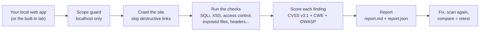
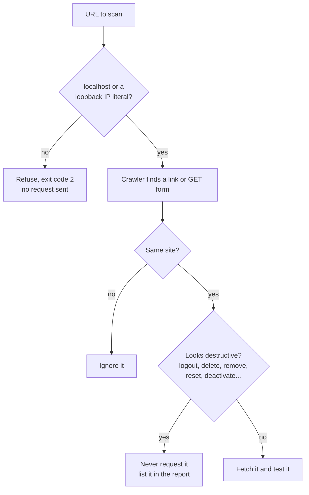
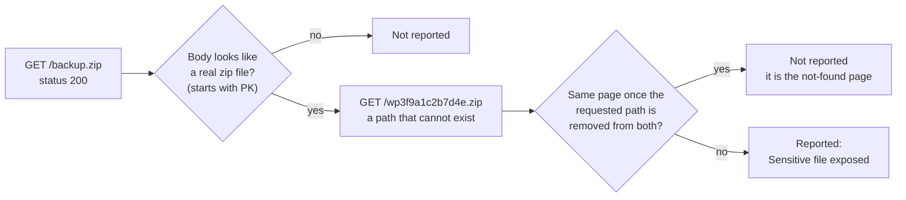
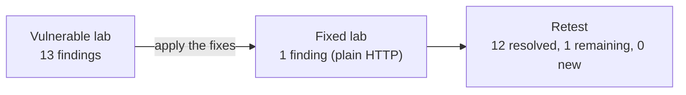
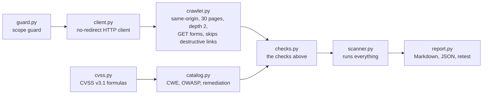

# WebProbe

A small, **local-only** web vulnerability scanner written in pure Python (standard library, no dependencies), bundled with a deliberately vulnerable demo app so you can run a full **assess → fix → retest** cycle on your own machine.

It checks for the issues behind several OWASP Top 10 (2021) categories, scores each finding with a built-in **CVSS v3.1** calculator, tags it with a **CWE** id, and writes a VAPT-style Markdown + JSON report.



## Safety by design

WebProbe refuses to scan anything that is not the local machine. The guard accepts only `http(s)://localhost` or a loopback IP literal (`127.0.0.1`, `[::1]`), does no DNS lookups, rejects `user@host` tricks such as `http://127.0.0.1@evil.com`, and the HTTP client never follows redirects. A refused target exits with code 2 before a single request is sent. The lab app also refuses to bind to anything but loopback.

WebProbe only sends GET requests, and its probes are harmless on their own: an inert marker tag for XSS, a lone quote and always-true/false conditions for SQL injection. But on a badly built app even a GET can change data (think `/logout` or `/items/delete?id=7`), so the crawler **skips links that look destructive and notes them in the report**. Those URLs are never requested by the crawler or by any check. The skip list is a word-based heuristic, so only scan apps you are allowed to test and can afford to reset.



## Setup

Needs Python 3.9 or newer. There are no runtime dependencies; the venv just keeps pytest and the `webprobe` command separate from your system Python.

```bash
python -m venv .venv
# Windows PowerShell:  .venv\Scripts\Activate.ps1
# Windows cmd:         .venv\Scripts\activate.bat
# macOS / Linux:       source .venv/bin/activate
pip install -r requirements-dev.txt      # installs webprobe (editable) + pytest
```

## Quick start

```bash
webprobe demo --out webprobe-out     # scan vulnerable lab, scan fixed lab, write reports + retest
pytest -q                            # 66 tests
```

Or step by step, in separate terminals (`python -m webprobe ...` works too):

```bash
webprobe lab                         # vulnerable app on http://127.0.0.1:8080
webprobe scan http://127.0.0.1:8080 --cookie session=1 --out out_before
webprobe lab --fixed --port 8081     # patched version
webprobe scan http://127.0.0.1:8081 --cookie session=1 --out out_after
webprobe compare out_before/report.json out_after/report.json --out retest.md
```

`--cookie` supplies one session cookie, which enables the IDOR check. `--ports` adds an opt-in TCP connect scan of common ports on localhost (IPv4 and IPv6).

## What it checks

| Check | What it looks for | CWE | OWASP 2021 |
|---|---|---|---|
| SQL injection | DB error leak after a lone quote; boolean-based true/false response difference | CWE-89 | A03 |
| Reflected XSS | An inert `<wpx...>` marker returned unescaped in HTML | CWE-79 | A03 |
| Missing authentication | Privileged paths (`/admin`, ...) showing real content to an anonymous request (not the not-found page, not a login form) | CWE-306 | A01 |
| IDOR | One session reading several different records through an id parameter | CWE-639 | A01 |
| Exposed files | `.env`, `.git/HEAD`, backups, `phpinfo`: the body must match the real file's signature and must not be the app's not-found page | CWE-538 | A05 |
| Security headers | CSP, X-Content-Type-Options, X-Frame-Options (or CSP `frame-ancestors`), Referrer-Policy | CWE-693 | A05 |
| Server banner | Version information in the `Server` header | CWE-200 | A05 |
| Cookie flags | A cookie set without HttpOnly | CWE-1004 | A05 |
| Plain HTTP | Target not using TLS | CWE-319 | A02 |
| Open ports (opt-in) | TCP connect scan of common ports | CWE-200 | A05 |

### Telling real pages from "not found" pages

Many apps answer every unknown URL with HTTP 200 and a friendly "page /x does not exist" message (a *soft 404*). To avoid reporting those as exposed files or open admin pages, WebProbe asks for a random decoy path of the same shape and compares the two answers:



## Results on the bundled lab

Output of `webprobe demo` (real run, see `docs/`):

| | Findings |
|---|---|
| Vulnerable lab | 13 (2 critical, 2 high, 2 medium, 6 low, 1 info) |
| Fixed lab | 1 (info: plain HTTP, expected on a local test target) |
| Retest | 12 resolved, 1 remaining, 0 new |



The fixes in `--fixed` mode: HTML escaping, parameterized queries with integer validation, an ownership check on profiles, authentication and role check on `/admin`, removal of the exposed files, security headers, a generic Server banner, and `HttpOnly; SameSite=Strict` cookies.

Sample reports: `docs/example_report_vulnerable.md` and `docs/example_retest.md`.

## Tested beyond the lab

The lab is well behaved, so on its own it could not reveal false positives. `tests/test_realistic_app.py` scans a second, more realistic local app that returns soft 404s echoing the path, shows a login form at `/admin`, links to `/logout` and `/items/delete?id=7`, and uses CSP `frame-ancestors` instead of X-Frame-Options. The tests check that WebProbe reports none of those as problems, never requests the destructive links, and still finds two genuine issues hidden among the soft 404s.

## How it works



`cvss.py` implements the CVSS v3.1 base-score formulas and is tested against known scores (9.8, 6.1, 7.5, 6.5, 9.1, 0.0). `catalog.py` holds CWE/OWASP tags, vectors and remediation text. Text that comes from the target is escaped before it goes into the Markdown report.

## Limitations

- Heuristic detection: findings are candidates to verify; a clean scan does not prove a target is secure.
- GET requests only. No POST forms, uploads, CSRF, SSRF, TLS configuration or dependency scanning.
- The destructive-link filter is word-based. It can skip a harmless link (shown in the report notes) and cannot know about a dangerous link with an innocent name, so only scan apps you can afford to reset.
- Boolean-based SQL injection compares whole responses, so pages that change on every request (timestamps, CSRF tokens) can hide it.
- IDOR is reported when one session can read several distinct records, so confirm manually whether that account is meant to see them.
- It is a learning and portfolio project, not a replacement for tools like Burp Suite or OWASP ZAP.

## Tests

`pytest -q` runs 66 tests: scope guard (including bypass attempts), redirect handling, CVSS known values, crawler, the full vulnerable and fixed lab scans (exact finding counts and no false positives), a realistic app with soft 404s, a login form and destructive links, destructive-link detection, retest comparison, reports and escaping, port scan (IPv4 and IPv6) and CLI behaviour.
